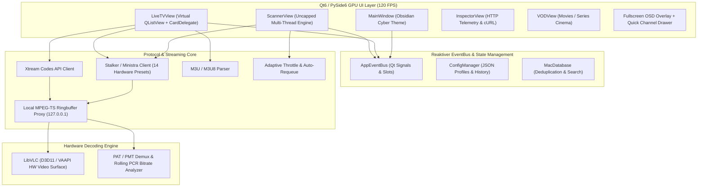

# ⚡ STB-Emulator Pro by InfoHazard & H7CFoX

<p align="center">
  
</p>

<p align="center">
  <b>High-Performance Qt6 IPTV Cyber-Cinema, Protocol-Inspector & Multi-Thread MAC Pentesting Suite</b><br>
  Entwickelt für Red-Team Security-Analysen, Stalker/Ministra Middleware-Probing und kompromissloses 120-FPS 4K UHD Streaming.
</p>

<p align="center">
  
  
  
  
  
  
</p>

---

## 📑 Inhaltsverzeichnis

- [Überblick](#-überblick)
- [Architektur-Highlights](#-architektur-highlights)
- [Kernfeatures im Detail](#-kernfeatures-im-detail)
  - [1. Live TV View & Virtualisierte Senderliste](#1-live-tv-view--virtualisierte-senderliste)
  - [2. High-Throughput MAC Scanner & Pentest Engine](#2-high-throughput-mac-scanner--pentest-engine)
  - [3. Dynamische Scan-Repository & Profilverwaltung (`mac_scans/`)](#3-dynamische-scan-repository--profilverwaltung-mac_scans)
  - [4. Stalker & Xtream Protocol Engine mit Auto-Resolution](#4-stalker--xtream-protocol-engine-mit-auto-resolution)
  - [5. Flow-Control Stream Buffer & Zero-Drop Ringbuffer Proxy](#5-flow-control-stream-buffer--zero-drop-ringbuffer-proxy)
  - [6. Interaktiver HTTP & Telemetrie Inspector](#6-interaktiver-http--telemetrie-inspector)
  - [7. VOD & Serien-Cinema](#7-vod--serien-cinema)
  - [8. Background Jobs & Stream Recorder](#8-background-jobs--stream-recorder)
  - [9. Picture-in-Picture (PiP), Kino- & Vollbild-OSD](#9-picture-in-picture-pip-kino---vollbild-osd)
- [Installation & Schnellstart](#-installation--schnellstart)
- [Tastaturkürzel (Hotkeys)](#-tastaturkürzel-hotkeys)
- [Stalker Scanner Leitfaden & Best Practices](#-stalker-scanner-leitfaden--best-practices)
- [Dateistruktur](#-dateistruktur)
- [Ethical Pentesting & Grayhat Disclaimer](#-ethical-pentesting--grayhat-disclaimer)

---

## 🌟 Überblick

**STB-Emulator Pro** ist eine vollständige, modulare Neuentwicklung von IPTV- und STB-Emulationssoftware auf Basis von **Python 3.12** und **Qt6 (`PySide6`)**. Die Anwendung kombiniert ein hardwarebeschleunigtes High-End Cyber-Cinema mit einer professionellen Pentesting- und Protocol-Reverse-Engineering-Suite für Stalker/Ministra-Portale, Xtream Codes v2 APIs und M3U8-Playlists.

Die App ersetzt ältere, auf Polling basierende Benutzeroberflächen durch eine reaktive **EventBus-Architektur** (`QThreadPool` + `QObject`-Signals) und rendert selbst Kataloge mit über **100.000 Kanälen** bei stabilen **120 FPS** mit weniger als **1 ms Such- und Filterlatenz** bei **0 % CPU-Last im Leerlauf**.

---

## ⚡ Architektur-Highlights



---

## 🚀 Kernfeatures im Detail

### 1. Live TV View & Virtualisierte Senderliste
* **120 FPS GPU-Virtualisierung**: Nutzung von `QAbstractListModel` + `QSortFilterProxyModel` + eigenem `ChannelCardDelegate`. Nur sichtbare Zeilen werden per `QPainter` gerendert – kein Ruckeln oder Speicherleck bei gigantischen Senderlisten.
* **Smart Filter-Pills**: Schnellumschaltung zwischen `Alle`, `⭐ Favoriten`, `🕘 Zuletzt gespielt` und `HD / 4K`.
* **Kategorie-Schnellsuche & Group-Preview**: Beim Wechsel einer Kategorie werden EPG-Daten und Senderlogos automatisch im Hintergrund geladen und gecacht.
* **Zwei-Phasen Kategorie-Validator & Auto-Thumbnails**:
  * **Phase 1 (Paralleler Health-Check)**: Überprüft alle Sender einer Gruppe blitzschnell mit bis zu 8 Threads auf Erreichbarkeit, Ping/Latenz und echte Decodier-Qualität (`FHD`, `HD`, `UHD`).
  * **Phase 2 (Automatischer Thumbnail-Grabber)**: Startet im Anschluss **vollautomatisch** für alle Online-Sender der Gruppe, die noch kein Bild im Disk-Cache haben. Ein schonender 2-Worker-Pool (4,5s FFmpeg-Timeout) schützt vor Provider-Sperren (HTTP 459 / 429).
  * **Echtzeit-Aktualisierung**: Jedes geladene Thumbnail poppt sofort in der Senderkarte auf und wird dauerhaft in `.cache/thumbs/` gecacht.
  * **Schnittiger 18px Fortschrittsbalken**: Dynamischer Farbverlauf (Indigo-Cyan-Emerald) und klar lesbarer Text ohne vertikales Abschneiden (`🩺 Prüfe Sender: X/Y (Z%)` / `📸 Lade Vorschaubilder: X/Y (Z%)`).
  * **Sofortiger Abbruch**: Der `⏹ Stopp`-Button beendet Prüfung und Thumbnail-Abruf verzögerungsfrei.
  * **Manuelle On-Demand Abfrage**: Rechtsklick auf die Senderliste -> `📸 Vorschaubilder für sichtbare Sender laden`.
* **1-Click M3U8-Export**: Exportiert die aktuelle Auswahl, Kategorie oder Favoritenliste direkt als normgerechte `.m3u8` inklusive Provider-spezifischem User-Agent.

### 2. High-Throughput MAC Scanner & Pentest Engine
* **Uncapped Multi-Thread Engine**: Frei konfigurierbar bis zu **250 parallele Worker-Threads** mit Micro-Delays (`0 ms`, `20 ms`, `50 ms`, `100 ms` bis `2500 ms`).
* **Session Cookie Isolation**: Zwingendes `session.cookies.clear()` vor jedem einzelnen MAC-Handshake verhindert Session-Cross-Contamination (`PHPSESSID`) zwischen Accounts.
* **1-Time Preflight Endpoint Discovery**: Ermittelt und cacht den korrekten Stalker-Endpunkt (`load_url` vs. `portal.php`) einmalig vor dem Start – spart bis zu 6 spekulative Fallback-Requests pro MAC-Check.
* **Lightweight Channel Probing**: Kein schwerer Vollkatalog-Download mehr. Fragt ausschließlich `get_ordered_list(genre='*', p='1')` ab und liest das `total_items`-Feld aus (~2 KB Payload, ~100 ms Abfragezeit).
* **Resilientes Auto-Requeue**: Aktive Accounts mit Ablaufdatum in der Zukunft, deren Kanalzählung unter hoher Last in einen transienten Timeout, HTTP 503 oder 429 läuft, werden **nicht** als 0-Kanal-Fehlschlag gewertet, sondern automatisch mit `[⏳ Requeue]` hinten angestellt.
* **Dynamische Live-Steuerung bei Pause & Resume**: Threads und Delays können während des Scans oder im Pausenmodus geändert werden. Die Engine skaliert Worker dynamisch nach oben oder unten.
* **OUI-Presets & Masken-Generator**: Schnellauswahl gängiger MAC-Präfixe (MAG 250, 254, 322, 420, Formuler, Infomir) und flexible Wildcard-Generierung (`00:1A:79:XX:XX:XX`).
* **Ordner-Import & Auto-Deduplizierung**: Rekursiver Import beliebiger Textdateien mit automatischer Normalisierung und Duplikat-Filterung.
* **Strukturierter Block-Hit-Export**: Exportiert ausschließlich verifizierte `HOT`-Treffer (`tag == 'hot'` und `channels > 0`) im standardisierten Format:
  * **Dateiname**: `<hostname>_<hits>hits_<YYYY-MM-DD>.txt`
  * **Format**:
    ```text
    ---------------------------------------------
    Portal: http://iptvgarden.streamtv.to:8080/c/
    Status: Aktiv
    Mac: 00:1A:79:BB:43:5D
    Scandate: 2026-10-17 13:45:00
    Expire: October 20, 2027, 6:46 pm
    Channels: 904
    ---------------------------------------------
    ```

### 3. Dynamische Scan-Repository & Profilverwaltung (`mac_scans/`)
* **Automatisches Einlesen aus `mac_scans/`**: Die App liest alle strukturierten Trefferdateien (`*.txt`) automatisch ein und gruppiert sie nach Portalen und Hosts.
* **2-stufige Profilauswahl**:
  * **Host-Auswahl**: Wähle das gewünschte Portal / den gescannten Host (zeigt Live-Hits und maximale Kanalanzahl).
  * **Login-Auswahl**: Alle Accounts des Portals direkt im Dropdown (`MAC • Kanäle • Ablaufdatum`), sortiert nach Kanalanzahl (beste Accounts mit den meisten Sendern ganz oben).
* **Live Account-Details**: Kompakte Anzeige von Status (`🟢 Aktiv`), Kanalzahl, Ablaufdatum und Scandatum.
* **Automatische Synchronisation**: Bei Auswahl eines Accounts werden Portal-URL und MAC-Adresse sofort in die Schnellverbindungs-Felder übernommen.
* **QoL-Werkzeuge**: Schnellbutton `🔄 Neu laden` (rescannt den Ordner zur Laufzeit) und `📂 Ordner` (öffnet den Scans-Ordner direkt im Explorer).

### 4. Stalker & Xtream Protocol Engine mit Auto-Resolution
* **14 STB-Hardware Presets**: MAG 250, MAG 254, MAG 322, MAG 420, MAG 520, AuraHD, Formuler Z8, BuzzTV XRS4500, Android TV STB, uvm.
* **Standard-MAC-Hashing & Hardware-Signatur**:
  * Vollständig reverse-engineered aus bewährten Pentest-Tools (`Zenith_Nexus`, `API_MAC_SCANNER`, `MacScan`).
  * Mathematisch exakte Ableitung: `sn = MD5(mac)[:13]`, `dev1 = SHA256(mac)`, `dev2 = SHA256(sn + '+' + mac)`, `sig = dev2`.
* **Intelligente Stream-Link Resolution**:
  * Erkennt vorformatierte URLs in `cmd` (z. B. `ffmpeg http://pro.8k-strong.tv:80/play/live.php?mac=...&stream=1537489...`).
  * Löst das Problem leerer `&stream=&`-Parameter und `id: null`, indem native MAG-Kandidaten (`ffmpeg http://localhost/ch/{ch_id}_`) priorisiert angefragt werden.
  * **Auto-Patching für `&sn2=`**: Erkennt leere Seriennummer-Felder und injiziert automatisch die passende `device_id2`, um HTTP 511 (*Network Authentication Required*) auf Restreamer-Servern zu verhindern.
* **IPTV Edge Status-Code Diagnostik**:
  * Erkennung und transparente Meldung in der UI (`HeroCard` & Status-Badges) statt unverständlicher Abstürze:
    * `HTTP 456`: Geo-Lock / ISP-Datacenter-ASN-Sperre oder Multi-Connection-Limit.
    * `HTTP 407`: Proxy erforderlich / Provider verlangt IP im Ursprungsland.
    * `HTTP 459`: Stream-Leitung belegt (Concurrent Limit).
    * `HTTP 511`: Cloudflare WAF Edge Challenge / Device Auth erforderlich.
    * `HTTP 429`: Server-Rate-Limit (5s Cooldown).
  * Automatischer Ausschluss von unbilled Dummy-Accounts (`Expire: 0000-00-00 00:00:00`).
* **Stalker v5 Handshake Flow**: Automatische Aushandlung von Token, Random-Salt, Bearer-Authentifizierung und Endpoint-Discovery (`/c/`, `/portal.php`, `/server/load.php`).

### 5. Flow-Control Stream Buffer & Zero-Drop Ringbuffer Proxy
* **Lokaler Loopback HTTP Proxy**: Einbindung von LibVLC über `http://127.0.0.1:<port>/stream`.
* **Upstream Flow-Control Pacing**: Verhindert unkontrolliertes Vorsaugen in die Live-Kante des Providers. Stoppt das Upstream-Lesen exakt am eingestellten Pufferziel (z. B. 15 s) und verhindert Anti-Scrape-Server-Trennungen.
* **Zero-Drop Chunk Eviction**: Chunks im Ringpuffer werden erst freigegeben, wenn der Player sie physisch gelesen hat. Kein Paketverlust, kein Bildruckeln und keine NAL-Artefakte.
* **Rolling PCR Mux-Bitrate**: Kontinuierliche Berechnung der Bitrate direkt aus den MPEG-TS Program Clock References (PCR) für absolut stabile Pufferberechnungen ohne Jitter.
* **Single-Writer Sequence Guard**: Atomarer Sequenz-Schutz verhindert, dass parallele Socket-Probes von VLC den Datenstrom korrumpieren.

### 6. Interaktiver HTTP & Telemetrie Inspector
* **Live Request & Response Logging**: Protokolliert jeden API-Aufruf, Handshake-Request und Token-Refresh.
* **JSON Syntax Highlighting**: Strukturierte und formatierte Darstellung aller Serverantworten.
* **1-Click cURL Generator**: Generiert mit einem Klick das exakte Terminal-Kommando (inkl. Headers, Cookies, User-Agent und Hardware-Tokens) zur Reproduktion in Postman, Terminal oder Bash-Skripten.
* **Handshake Tester**: Einzelne MACs oder Zugangsdaten direkt gegen das Portal testen, ohne die Senderliste laden zu müssen.

### 7. VOD & Serien-Cinema
* **Modernes Poster-Grid & List-View**: Schnelle Suche und Sortierung nach IMDb-Rating, Titel, Genre und Veröffentlichungsjahr.
* **Persistente Favoriten**: VOD-Favoriten werden dauerhaft in `config.json` gespeichert.
* **Serien- & Staffelauswahl**: Komfortabler Episoden-Browser mit Inhaltsangabe und Stream-Informationen.

### 8. Background Jobs & Stream Recorder
* **Live HLS/TS-Recording**: Sofortige Aufnahme des laufenden Live-Programms mit einem Klick (`[R]`).
* **VOD Downloader**: Paralleler Download von Filmen und Serienfolgen im Hintergrund mit Fortschrittsanzeige und automatischer Wiederaufnahme bei Netzwerkunterbrechung.

### 9. Picture-in-Picture (PiP), Kino- & Vollbild-OSD
* **PiP Mode (`[P]`)**: Schaltet die App in einen rahmenlosen, immer im Vordergrund schwebenden Mini-Player am Bildschirmrand.
* **Kinomodus (`[T]`)**: Blendet die gesamte Navigation aus und fokussiert zu 100 % auf das Video.
* **Fullscreen OSD (`F11`)**: Vollbildanzeige mit elegantem, nach Inaktivität transparent ausblendendem OSD-HUD (aktuelle Sendung, EPG-Restzeit, Codec-Pills, Auflösung) und einblendbarem Quick-Channel-Drawer (`[C]`).

---

## 🛠 Installation & Schnellstart

### Voraussetzungen
1. **Windows 10 / 11 (64-Bit)**
2. **Python 3.12+** (64-Bit)
3. **VLC Media Player (64-Bit)** installiert (für die Bereitstellung von `libvlc.dll` und den Codec-Plugins unter `C:\Program Files\VideoLAN\VLC`).

### 1. Repository klonen & Verzeichnis wechseln
```bash
git clone https://github.com/InfoHazard-H7CFoX/stb-pro-qt6.git
cd stb-pro-qt6
```

### 2. Virtuelle Umgebung einrichten & Abhängigkeiten installieren
```powershell
python -m venv .venv
.\.venv\Scripts\activate
pip install -r requirements.txt
```

### 3. Starten
Entweder per Doppelklick auf die beiliegende **`start_qt6.bat`** oder direkt im Terminal:
```powershell
.\.venv\Scripts\python.exe main.py
```

---

## ⌨️ Tastaturkürzel (Hotkeys)

| Taste | Kontext | Funktion |
|---|---|---|
| `F11` / Doppelklick | Video | Vollbildmodus mit transparentem OSD-HUD umschalten |
| `C` | Vollbild | Schnell-Senderliste (Quick-Channel-Drawer) rechts ein-/ausblenden |
| `P` | Global | Picture-in-Picture (PiP) Always-on-Top Mini-Player umschalten |
| `T` | Global | Kinomodus (Seitenleiste & Banner ausblenden) umschalten |
| `Esc` | Player | Vollbild-, PiP- oder Kinomodus verlassen |
| `Leertaste` | Video | Wiedergabe / Pause |
| `M` | Video | Audio stummschalten (Mute) |
| `PgUp` / `PgDn` | Live TV | Vorheriger / Nächster Sender (Direct Zapping) |
| `R` | Live TV | Sofortaufnahme starten / stoppen (`REC`) |
| `F2` | Senderliste | Ausgewählten Sender als Favorit markieren / entfernen |
| `Ctrl+F` | Global | Suchfeld der Senderliste fokussieren |

---

## 🎯 Stalker Scanner Leitfaden & Best Practices

Folgende Richtlinien garantieren maximale Scan-Geschwindigkeit bei minimalem Risiko von WAF/Cloudflare-Bans:

1. **Endpoint-Caching nutzen**: Vor dem Start eines Massenscans ermittelt die Suite automatisch, ob das Portal `/c/`, `/portal.php` oder `/server/load.php` erwartet. Dieser Endpunkt bleibt während des gesamten Scans gecacht.
2. **Thread- & Delay-Pacing**:
   * *Lokale / Ungeschützte Portale*: 50–100 Threads mit `0 ms` oder `20 ms` Delay erreichen bis zu **15–25 Checks/s**.
   * *Cloudflare / WAF-geschützte Portale*: 20–30 Threads mit `250 ms` oder `500 ms` Delay verwenden.
   * *Dynamische Anpassung*: Wenn die Trefferrate sinkt oder Timeouts steigen, einfach `[⏸ PAUSIEREN]`, Delay erhöhen und `[▶ FORTSETZEN]` klicken.
3. **Session-Isolation beachten**: Jeder Worker arbeitet in einer isolierten Session. Cookies werden automatisch vor jedem Handshake gelöscht, sodass keine ungültigen Tokens verschleppt werden.
4. **Hit-Export**: Nutzen Sie die Filter-Pill `HOT (N)` und klicken Sie auf `💾 EXPORT`. Es werden nur echte Treffer mit gebuchten Kanälen exportiert.

---

## 📂 Dateistruktur

```text
stb_pro_qt6/
├── .github/workflows/      # GitHub Actions CI/CD Pipeline
│   └── ci.yml              # Automatisierte Matrix-Tests (Windows/Ubuntu, Py3.11/3.12)
├── clients/                # Protokoll-Clients & Network Stacks
│   ├── stb_client.py       # Stalker/Ministra MAG Client (v5 Handshake, SN2 Auto-Patching)
│   ├── xtream_client.py    # Xtream Codes API v2 Client
│   ├── m3u_client.py       # M3U/M3U8 Parser & Header Extractor
│   └── throttle.py         # Adaptiver Scan-Rate-Limiter & Requeue-Controller
├── core/                   # Kernarchitektur, Modelle & Hintergrunddienste
│   ├── config_manager.py   # Persistenz für Profile, VOD-Favoriten & History
│   ├── logo_cache.py       # Asynchroner Disk- & RAM-Logo-Cache
│   ├── mac_database.py     # MAC-Datenbank mit Duplikatprüfung & Tagging
│   ├── models.py           # Dataclasses (Channel, Profile, ScanResult, HttpLog)
│   ├── preview_grabber.py  # Hintergrund-Thumbnail-Grabber für Vorschauen (0.12s TS-Extraction)
│   ├── recorder.py         # Live-Stream & VOD Recorder-Engine
│   ├── signals.py          # Reaktiver AppEventBus (Qt Signals & Slots)
│   ├── stream_buffer.py    # Zero-Drop Ringbuffer HTTP Proxy mit Flow-Control
│   └── stream_probe.py     # Multi-Thread Stream- & Codec-Analyzer
├── player/                 # Wiedergabe-Engine
│   ├── external_player.py  # Anbindung von externem VLC, MPV & FFplay
│   ├── osd_overlay.py      # Transparentes Vollbild-OSD & Channel-Drawer
│   └── vlc_controller.py   # LibVLC Controller (HW-Surface, Tracks, Speed)
├── tools/                  # Entwickler- & Wartungs-Werkzeuge
│   └── generate_code_index.py # Deterministischer AST Code-Index & Symbol-Register Generator
├── ui/                     # Qt6 Benutzeroberfläche
│   ├── components/         # Wiederverwendbare UI-Elemente (TopBar, HeroCard, EPG)
│   ├── dialogs/            # Modale Dialoge (Profile, Puffer, Jobs, MAC-DB, Guide)
│   ├── models/             # QAbstractListModel / QAbstractTableModel Implementierungen
│   ├── views/              # Hauptansichten (LiveTV, VOD, Scanner, Inspector, Konsole)
│   └── theme.py            # "Obsidian Cyber-Cinema" Theme (QSS Stylesheet & Colors)
├── tests/                  # Automatisierte Unit- & Integrations-Tests
│   ├── test_ui_and_engine.py  # Haupt-Testsuite (100% Pass)
│   └── manual/             # Manuelle Verifikations- & Probe-Skripte
├── ARCHITECTURE.md         # Detaillierte Architekturdokumentation
├── CHECKPOINTS.md          # Entwicklungs-Checkpoints & Audit-Historie
├── CODE_INDEX.md           # Vollständiges Code- & Symbol-Register (Zeilen-exakt)
├── LICENSE                 # Offizielle MIT-Lizenz
├── pyproject.toml          # PEP 517/621 Build-Konfiguration & Metadaten
├── config.example.json     # Sanitized Beispiel-Konfiguration
├── main.py                 # Anwendungs-Einstiegspunkt
├── requirements.txt        # Python-Abhängigkeiten
└── start_qt6.bat           # 1-Click Windows-Starter
```

---

## ⚖️ Ethical Pentesting & Grayhat Disclaimer

> [!CAUTION]
> **Wichtiger rechtlicher Hinweis**:
> Dieses Tool wurde ausschließlich zu Forschungs-, Bildungs- und autorisierten Red-Team-Auditzwecken entwickelt. Das Scannen und Zugreifen auf Portale und Netzwerke ohne vorherige ausdrückliche Genehmigung des jeweiligen Betreibers ist illegal. Die Entwickler übernehmen keinerlei Haftung für Missbrauch oder Schäden, die durch den Einsatz dieser Software entstehen. Bitte halten Sie sich an die geltenden Gesetze Ihrer jeweiligen Jurisdiktion.
